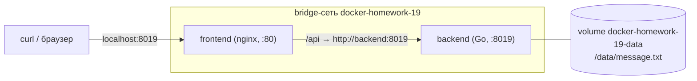

# Отчёт: docker-homework-19

Студент: Штыфман Георгий Владимирович  
Вариант: 19
Персональный идентификатор: `0e9cccb4`
Неисправность: опубликован неправильный внутренний порт frontend

## Схема стенда



- frontend: `docker-homework-19-frontend:v19`, 0.5 CPU, 64 МБ, публикует `8019 → 80`.
- backend: `docker-homework-19-backend:v19`, 0.5 CPU, 128 МБ, порт на хост не публикуется.

## Проверки рабочего стенда

**`/` и `/api`**

```text
$ curl -s -o /dev/null -w "/ %{http_code}\n" http://localhost:8019/      → / 200
$ curl -s -o /dev/null -w "/api %{http_code}\n" http://localhost:8019/api → /api 200
$ curl http://localhost:8019/api/info
Георгий Штыфман вариант 19 0e9cccb4
hostname: 285aa6a51d0d
message: I am thou, thou art I
```

**Сеть.** Оба контейнера в пользовательской сети `docker-homework-19`, обращение по имени:

```text
docker-homework-19-backend  172.19.0.2/16
docker-homework-19-frontend 172.19.0.3/16
$ docker exec docker-homework-19-frontend wget -qO- http://backend:8019/api/info   → ответ backend
$ docker port docker-homework-19-backend                                            → (пусто)
$ curl --max-time 3 http://localhost:8080/api                                       → код 000, недоступно
```

**Лимиты и healthcheck.**

```text
backend  health=healthy cpu=500000000 mem=134217728   (0.5 CPU, 128 МиБ)
frontend health=healthy cpu=500000000 mem=67108864    (0.5 CPU, 64 МиБ)
$ docker stats --no-stream
docker-homework-19-frontend 0.00% 10.25MiB / 64MiB
docker-homework-19-backend  0.00% 5.344MiB / 128MiB
```

**Volume.** В файл записан текст `persisted-check`, backend удалён (`docker rm -f`) и создан заново через `start.sh`:

```text
$ curl http://localhost:8019/api/info
hostname: 832a6d6d78ad          ← новый контейнер, другой hostname
message: persisted-check        ← данные сохранились
```

После проверки в файл возвращён исходный текст.

**Multi-stage build.** Backend написан на Go и компилируется, поэтому использован multi-stage build (`golang:1.27-alpine` → `alpine:3.22`). Во frontend компиляции нет: это nginx со статикой, и multi-stage там не нужен.

## Расследование неисправности

Сначала получен рабочий стенд (см. выше). Затем внесена поломка: контейнер frontend запущен с неверным внутренним портом публикации:

```bash
FRONTEND_INTERNAL_PORT=8080 ./scripts/start.sh
# внутри start.sh: -p 8019:8080, хотя nginx слушает 80
```

### 1. Симптом

Стенд «запущен», контейнеры `Up` и `healthy`, но через персональный порт ответа нет:

```text
$ curl -v --max-time 5 http://localhost:8019/
* Recv failure: Connection reset by peer
curl: (56) Recv failure: Connection reset by peer
```

### 2. Гипотезы

1. frontend (nginx) не работает или упал.
2. Проблема в сети или в backend: frontend не видит backend.
3. Порт хоста 8019 проброшен не на тот порт внутри контейнера frontend.

### 3. Проверки и результаты

| Команда | Результат | Вывод |
|---|---|---|
| `docker ps -a` | frontend `Up (healthy)`, порты `80/tcp, 0.0.0.0:8019->8080/tcp` | контейнер жив (гипотеза 1 не подтверждается); в портах видно `8019->8080` |
| `docker logs docker-homework-19-frontend` | nginx стартовал, воркеры запущены, ошибок нет; в access-логе только запросы healthcheck с `127.0.0.1` | запросы с хоста до nginx не доходят |
| `docker exec ...frontend wget -qO- http://backend:8019/api/info` | ответ backend получен | сеть и backend в порядке (гипотеза 2 отпадает) |
| `docker network inspect docker-homework-19` | оба контейнера в сети | подтверждает предыдущий пункт |
| `docker port docker-homework-19-frontend` | `8080/tcp -> 0.0.0.0:8019` | публикуется порт 8080 |
| `docker inspect -f '{{json .HostConfig.PortBindings}}' ...` | `{"8080/tcp":[{"HostPort":"8019"}]}` | привязка хост-порта к 8080 подтверждена |
| `docker exec ...frontend grep listen /etc/nginx/conf.d/default.conf` | `listen 80;` | nginx слушает 80 |
| `wget http://127.0.0.1:80/` внутри контейнера | `HTTP/1.1 200 OK` | nginx внутри отвечает |
| `wget http://127.0.0.1:8080/` внутри контейнера | `Connection refused` | на 8080 никто не слушает |

### 4. Подтверждённая причина

Хост-порт 8019 опубликован на внутренний порт **8080** контейнера (`-p 8019:8080`), а nginx слушает порт **80**. Docker принимает соединение на хосте и пересылает его на порт 8080, где нет процесса, поэтому соединение сбрасывается (`Connection reset by peer`).

Healthcheck при этом зелёный, потому что он ходит на `127.0.0.1:80` изнутри контейнера и публикацию портов не проверяет. Контейнер здоров, но недоступен снаружи.

### 5. Исправление

Контейнер frontend пересоздан с правильным внутренним портом: `./scripts/start.sh` без переопределения `FRONTEND_INTERNAL_PORT`, то есть `-p 8019:80`.

### 6. Повторная исходная проверка

```text
$ docker port docker-homework-19-frontend      → 80/tcp -> 0.0.0.0:8019
$ docker ps                                    → 0.0.0.0:8019->80/tcp, (healthy)
$ curl -s -o /dev/null -w "%{http_code}" http://localhost:8019/      → 200
$ curl -s -o /dev/null -w "%{http_code}" http://localhost:8019/api   → 200
$ curl http://localhost:8019/api/info
Георгий Штыфман вариант 19 0e9cccb4 ...
```

## Три самостоятельных решения

1. **Резолвер Docker и переменная в `proxy_pass` (`resolver 127.0.0.11`, `set $backend ...`).** nginx резолвит имя `backend` при каждом запросе, а не один раз на старте. Если backend пересоздан и получил новый IP (как в проверке volume), frontend продолжает работать. Иначе nginx упал бы при старте, пока backend не поднят, или держал бы устаревший IP.
2. **Network alias `backend` и `frontend`.** Конфигурация nginx не зависит от имени контейнера, которое содержит номер проекта. Имя контейнера можно менять, не трогая конфиг.
3. **Внутренний порт frontend вынесен в переменную `FRONTEND_INTERNAL_PORT` (по умолчанию 80).** Неисправность варианта воспроизводится одной переменной окружения, без правки скрипта, а исправление — обычный перезапуск. Лимиты и пересоздание контейнеров при этом остаются в одном месте.

## Недостаток и способ улучшения

Healthcheck проверяет только `127.0.0.1` внутри контейнера, поэтому не заметил неисправность с опубликованным портом: контейнер был `healthy`, а сервис снаружи не отвечал. Улучшение: добавить в `start.sh` сквозную проверку после запуска (`curl --fail http://localhost:$PORT/api` с несколькими повторами) и завершать скрипт с ошибкой, если она не проходит. Backend при этом можно проверять через `/api/info`, чтобы заодно убедиться, что volume читается.

## Скриншот

[](https://postimg.cc/G85XWdFp)